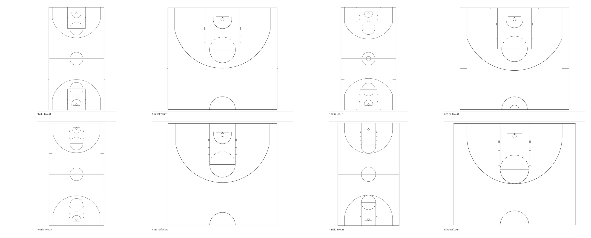

# remarkable-templates

A toolkit for building reMarkable paper templates, and the template families
built with it.

[](https://github.com/Excoriate/remarkable-templates/actions/workflows/build.yml)
[](LICENSE)
[](LICENSE-ART)

One family ships today: **basketball courts**, drawn from the rule books at
native Paper Pro resolution rather than traced or upscaled.



## Quick start

```bash
just setup      # create .venv and install dependencies
just all        # build every family, generate docs, verify
just install    # copy onto a tablet over SSH
```

No developer mode? The build also writes PDFs you can drop into the reMarkable
app. Both routes, and everything else, are in the
**[user guide](docs/USER_GUIDE.md)**.

## What is here

| | |
| --- | --- |
| **Basketball** | NBA, NCAA, FIBA and NFHS high school. Each as a full court in portrait and a half court in landscape. |
| **The toolkit** | Device canvases, SVG → PNG/PDF rendering, `templates.json` merging, an SSH installer that survives firmware updates, and verification that measures the finished pixels. |
| **Your own PNGs** | `just ingest <folder> <name>` turns any folder of artwork into a template set. |

Built output lands in `templates/<set>/{png,svg,pdf}` with a `manifest.json`
beside it. Builds are byte-reproducible: rebuild from source and the files hash
the same as the ones committed here.

## Layout

```
src/rmtpl/        the toolkit — anything true of any reMarkable template
src/rmtpl/families/  one package per template family
templates/        built output, one directory per set
install/          SSH install and uninstall
docs/             user guide, format notes, generated references
```

A family is one package under `src/rmtpl/families/` exposing a `FAMILY` object. The
build, the manifest, the docs and the checks all iterate over whatever the
registry finds, so adding one changes nothing else —
see [CONTRIBUTING.md](CONTRIBUTING.md).

## Accuracy

Rule books dimension a marking to a specific *edge* of a painted line — the
NBA's three-point arc is 23 ft 9 in to the *outside* of a 2 in line — while a
drawing program strokes along a path *centre*. Every published figure is
converted once, with its measurement edge recorded next to it.
[The geometry reference](docs/families/basketball-court-geometry.md) lists every
number and its source, and is generated from the same specs the courts are drawn
from.

`just check` runs three kinds of verification: rule-book cross-checks that play
independently published figures against each other, file-contract checks, and
render checks that measure the finished pixels. The render checks derive scale
from the image, so those comparisons verify ratios; a separate check recomputes
the expected scale from published dimensions to catch a drawing that is
uniformly wrong. Three tests inject a defect and assert the checker fails, so
the verification is known to be able to.

## Licence

Code is [MIT](LICENSE). The generated templates are [CC0](LICENSE-ART) — court
geometry is published fact and these drawings are an original rendering of it.
See [NOTICE.md](NOTICE.md) for what this repository deliberately does not ship.
